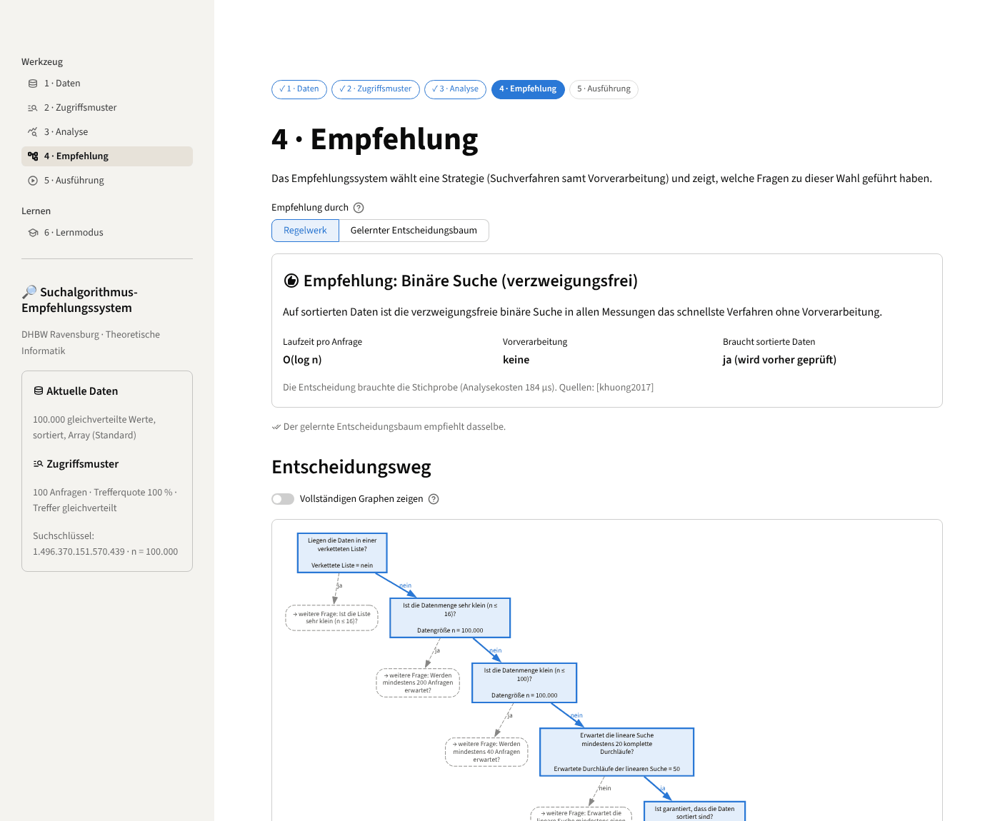
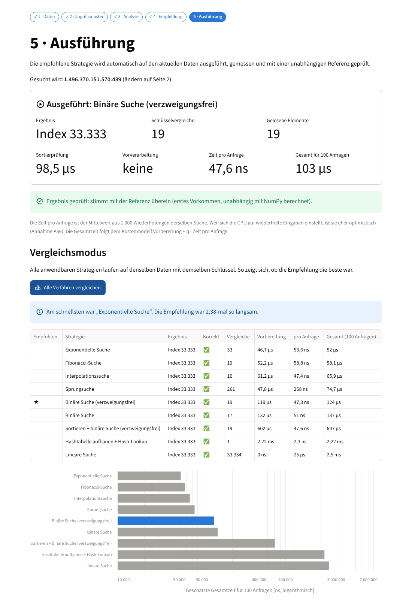
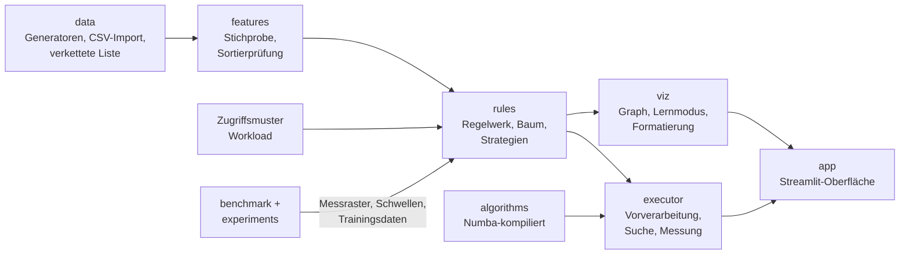

# Suchalgorithmus-Empfehlungssystem

Hochschulprojekt (DHBW Ravensburg, Modul Theoretische Informatik): ein Tool,
das anhand der Eigenschaften einer Datenmenge ein passendes **Suchverfahren
empfiehlt**, es **automatisch ausführt** und den **Entscheidungsweg grafisch
darstellt**. Ein Lernmodus zeigt die Verfahren Schritt für Schritt.



## Inhalt

- [Schnellstart](#schnellstart)
- [Bedienung der Oberfläche](#bedienung-der-oberfläche)
- [Wie die Empfehlung entsteht](#wie-die-empfehlung-entsteht)
- [Implementierte Suchverfahren](#implementierte-suchverfahren)
- [Architektur und Projektstruktur](#architektur-und-projektstruktur)
- [Experimente und Messreihen](#experimente-und-messreihen)
- [Tests](#tests)
- [Weitere Dokumentation](#weitere-dokumentation)

## Schnellstart

Voraussetzung: Python 3.11 oder neuer.

```bash
python3 -m venv .venv
source .venv/bin/activate
pip install -r requirements.txt
```

App starten (aus dem Hauptverzeichnis des Repositorys, damit das Farbschema in
`.streamlit/config.toml` gefunden wird):

```bash
streamlit run app/streamlit_app.py
```

Die App öffnet sich im Browser unter <http://localhost:8501>. Beim ersten
Aufruf der Ausführung werden alle Suchverfahren einmalig mit Numba kompiliert
(einige Sekunden).

## Präsentationsmodus

Die App startet mit dem **Überblick**: die Frage des Projekts, der Ablauf des
Tools in vier Schritten (nach dem Rahmen von Rice), die Kernergebnisse der
Bewertung aus `results/full/` und sechs **Geschichten** als Karten.

Jede Geschichte ist eine Alltagssituation, die zu einer anderen Empfehlung
führt, und wird in sechs Kapiteln erzählt: die Daten als Bild, der Steckbrief
aus der Stichprobe, die Entscheidung als Frage-Antwort-Kette (auf Wunsch als
Graph), ein animiertes Wettrennen mit gezählten Vergleichen auf allen Daten,
„Was wäre wenn?“ mit Kostenkurven und einem Regler für die Anzahl der Anfragen
und zum Schluss die Lehre in einem Satz. Alle Zahlen werden live auf den
Daten der Geschichte gemessen. Per Knopf lässt sich jede Geschichte ins
Werkzeug übernehmen.

| Geschichte | Situation | Empfehlung |
|---|---|---|
| 📞 Telefonbuch | sortiert, 1.000 Nachschläge | binäre Suche (nach Prüfung der Sortierung) |
| 📜 Logdatei | unsortiert, gesucht wird das Neueste | lineare Suche |
| 📦 Lagerbestand | unsortiert, 10.000 Abfragen | Hashtabelle |
| 🛒 Einkaufsliste | 10 Einträge | lineare Suche |
| 📈 Messwerte | sortiert, aber stark schief verteilt | binäre Suche, nicht Interpolationssuche |
| 🎵 Playlist | verkettete Liste, wenige Suchen | lineare Suche durch die Liste |

Die Texte der Geschichten werden von `tests/test_presentation.py` gegen das
Regelwerk geprüft.

## Bedienung der Oberfläche

Die App führt in fünf Arbeitsschritten durch das Tool. Eine Fortschrittsleiste
oben auf jeder Seite zeigt, wo du bist, und unten führt ein Link zum nächsten
Schritt. Links in der Seitenleiste stehen immer die aktuellen Daten und das
Zugriffsmuster.

| Schritt | Seite | Was passiert |
|---|---|---|
| 1 | **Daten** | Datenmenge erzeugen (Größe bis 10⁷, Verteilung, Sortiergrad, Duplikate, Array oder verkettete Liste) oder CSV hochladen. Histogramm und Diagramm „Wert über Position“ zeigen die Daten. |
| 2 | **Zugriffsmuster** | Suchschlüssel wählen (zufälliger Treffer oder Fehlschlag), Anzahl Anfragen, Trefferquote, Lage der Treffer, Sortiergarantie. Die App warnt, wenn die Sortierung garantiert wird, die Daten aber unsortiert sind. |
| 3 | **Analyse** | Merkmale per Stichprobe schätzen (Unordnung, Duplikate, KS-Abstand zur Gleichverteilung) samt Analysekosten, Verteilungsdiagramm, Bedeutung für die Verfahren, vollständige Sortierprüfung. |
| 4 | **Empfehlung** | Empfohlene Strategie mit Begründung, Komplexität und Quellen; Entscheidungsweg als Graph (Regelwerk oder gelernter Entscheidungsbaum), Vergleich beider Selektoren, Kostenmodell mit eingesetztem q, Export als DOT-Datei und ein animiertes Wettrennen der linearen Suche gegen das empfohlene Verfahren auf einem Ausschnitt der eigenen Daten. |
| 5 | **Ausführung** | Automatische Suche mit Ergebnis, Vergleichen, Zeiten und Gesamtkosten; jedes Ergebnis wird gegen eine unabhängige Referenz geprüft. Vergleichsmodus: alle Strategien als Tabelle und Diagramm. |
| 6 | **Lernmodus** | Suchverfahren Schritt für Schritt auf kleinen Arrays (bis 64 Werte), mit Blockgrenzen der Sprungsuche und einem Vergleich der Schrittzahlen aller Verfahren, oder als **Wettrennen** mehrerer Verfahren nebeneinander (gleiches Array, gleicher Schlüssel, ein Vergleich pro Takt). |



**CSV-Import:** Eine Spalte ganzer Zahlen genügt, mit oder ohne Überschrift.
Trennzeichen `;`, `,`, Tabulator und Leerzeichen werden erkannt. Leere Zellen
werden übersprungen; Nachkommastellen und Werte außerhalb von `int64` werden
mit einer verständlichen Meldung abgelehnt.

## Wie die Empfehlung entsteht

Das Empfehlungssystem wählt eine **Strategie**: ein Suchverfahren samt der
Vorverarbeitung, die es braucht (Sortierprüfung, Sortieren, Hashtabelle
aufbauen). Grundlage sind drei Arten von Merkmalen:

1. **Kostenlose Merkmale:** Datengröße n, Speicherstruktur und die Angaben des
   Nutzers zu den Anfragen (Anzahl q, Trefferquote, Lage der Treffer,
   Sortiergarantie). Daraus wird die erwartete Zahl kompletter Durchläufe der
   linearen Suche berechnet (`Workload.linear_scans`), die die meisten
   Amortisationsregeln steuert.
2. **Geschätzte Merkmale** auf einer Stichprobe (Standard 1 000 Paare):
   Anteil falsch geordneter Nachbarpaare, Duplikatanteil, KS-Abstand zur
   Gleichverteilung. Die Stichprobe kostet Zeit und wird nur gezogen, wenn ein
   Entscheidungsknoten sie braucht.
3. **Vollständige Sortierprüfung** (O(n)): Eine Stichprobe beweist keine
   Sortierung. Bevor ein Verfahren für sortierte Daten läuft, wird deshalb
   vollständig geprüft, außer der Nutzer garantiert die Sortierung.

Zwei Selektoren stehen zur Wahl:

- **Regelwerk** ([`src/recommender/rules/rules.yaml`](src/recommender/rules/rules.yaml)):
  ein Entscheidungsgraph mit Frage, Schwelle, Begründung und Quellen an jedem
  Knoten. Die Schwellen stammen aus den Messungen in `results/full/`.
- **Gelernter Entscheidungsbaum** (scikit-learn, Entropie, Tiefe 4), trainiert
  auf dem Messraster und gespeichert als `results/full/learned_tree.json`.

Bewertung auf dem Messraster (`results/full/recommender_summary.csv`, ohne
Analysekosten): Das Regelwerk trifft in 87 % der Fälle die beste Strategie,
ist im geometrischen Mittel nur 1,08-mal so langsam wie das Optimum und
schließt 97 % der Lücke zwischen „immer dieselbe Strategie“ und dem Optimum.

## Implementierte Suchverfahren

| Schlüssel | Verfahren | Voraussetzung | Komplexität | Quelle |
|---|---|---|---|---|
| `linear` | Lineare Suche | keine | O(n) | [vansandt2019] |
| `binary` | Binäre Suche | sortiert | O(log n) | [khuong2017] |
| `binary_branchless` | Binäre Suche (verzweigungsfrei) | sortiert | O(log n) | [khuong2017] |
| `jump` | Sprungsuche | sortiert | O(√n) | [shneiderman1978] |
| `exponential` | Exponentielle Suche | sortiert | O(log i) | [bentley1976] |
| `fibonacci` | Fibonacci-Suche | sortiert | O(log n) | [ferguson1960] |
| `interpolation` | Interpolationssuche mit Guard | sortiert, numerisch | O(log log n) erwartet, O(n) im Worst Case | [peterson1957], [perl1978], [gonnet1980], [vansandt2019] |
| `hash` | Hash-Lookup | Hashtabelle (Aufbau O(n)) | O(1) erwartet | [richter2015] |

Auf verketteten Listen gibt es zusätzlich `list_linear` und `list_jump`
(Rückgabe: Position in der Liste). Alle Verfahren liefern den Index des
**ersten** Vorkommens oder `-1` und liegen in einer Mess- und einer
Zählvariante vor (siehe [Code-Dokumentation](docs/code_dokumentation.md#2-suchverfahren-recommenderalgorithms)).

## Architektur und Projektstruktur



```
app/                        Streamlit-Oberfläche
  streamlit_app.py          Einstieg: Navigation, Seitenleiste
  views/common.py           gemeinsamer Zustand, Kopfzeile, Navigation
  views/charts.py           interaktive Diagramme (Altair)
  views/*_page.py           eine Datei pro Seite
src/recommender/            Python-Paket (alle Logik, ohne Oberfläche testbar)
  algorithms/               Suchverfahren (Numba), Registry mit Metadaten
  data/                     Datengeneratoren, Anfragen, verkettete Liste, CSV-Import
  features/                 Merkmale per Stichprobe, vollständige Sortierprüfung
  rules/                    Strategien, Regelwerk (rules.yaml), Entscheidungsbaum, Bewertung
  benchmark/                Messmethodik: Zeitmessung, Statistik, Umgebung, Messraster
  viz/                      Diagramme der Arbeit, Entscheidungsgraph, Lernmodus, Formatierung
  executor.py               automatische Ausführung einer Strategie
experiments/                Messreihen für die Ausarbeitung
results/full/               Ergebnisse der vollständigen Messreihe (CSV, PDF, Baum)
tests/                      pytest-Tests (Algorithmen, Daten, Regeln, Oberfläche)
docs/                       Annahmen, Code-Dokumentation, Änderungsprotokoll
.streamlit/config.toml      Farbschema (hell und dunkel)
```

## Experimente und Messreihen

Die Skripte in `experiments/` erzeugen die Messdaten (CSV mit
Umgebungsprotokoll) und Diagramme (PDF) für die Ausarbeitung.

```bash
python experiments/run_all.py --mode quick
```

```bash
python experiments/run_all.py --mode full
```

```bash
python experiments/run_all.py --plot-only
```

`quick` ist eine Funktionsprüfung (etwa 30 Sekunden), `full` die vollständige
Messreihe für die Arbeit, `--plot-only` zeichnet nur die Diagramme aus
vorhandenen CSV-Dateien neu. Ergebnisse landen in `results/quick/` bzw.
`results/full/`.

Vor der vollständigen Messreihe: Netzteil anschließen, **Stromsparmodus
ausschalten** (Systemeinstellungen → Batterie → Stromsparmodus „Nie“), andere
Programme schließen und den Rechner während der Messung nicht benutzen. Im
Stromsparmodus laufen alle Messungen etwa doppelt so langsam. Die Experimente
warnen davor, und jede Ergebnisdatei protokolliert Stromquelle und
Stromsparmodus. Prüfen unter macOS:

```bash
pmset -g | grep lowpowermode
```

| Skript | Merkmal | Ergebnis |
|---|---|---|
| `exp_size.py` | Datengröße | Laufzeit und Vergleiche über n, Speedup-Tabelle |
| `exp_size_datasets.py` | Datengröße (Robustheit) | wie `exp_size.py`, aber 5 Datensätze pro Größe (nicht in `run_all.py`, Rechnername über `--label`) |
| `exp_distribution.py` | Verteilung | Laufzeit je Verteilung (mit KS-Wert) |
| `exp_duplicates.py` | Duplikate | Laufzeit je Duplikatanteil |
| `exp_access_pattern.py` | Zugriffsmuster | Laufzeit je Muster |
| `exp_structure.py` | Speicherstruktur | Array gegenüber verketteter Liste |
| `exp_amortization.py` | Sortierung + Anfragen | Gesamtkosten T(q), Break-even-Punkte |
| `exp_analysis_cost.py` | Analysekosten | Kosten gegenüber Suche, Genauigkeit nach Stichprobengröße |
| `exp_grid.py` | alle Merkmale kombiniert | Messraster für das Empfehlungssystem (nur CSV) |
| `exp_recommender.py` | – | Bewertung von Regelwerk und Entscheidungsbaum, Tabellen (CSV, LaTeX) |

## Tests

```bash
pytest
```

551 Tests prüfen unter anderem jedes Suchverfahren gegen `np.searchsorted`
(auch mit Duplikaten, leeren Arrays und extremen `int64`-Werten), die
Datengeneratoren, die Merkmalsschätzung, Regelwerk und Bewertung, den
CSV-Import, die Zahlenformatierung und jede Seite der Oberfläche
(Streamlit-`AppTest`). GitHub Actions führt die Tests bei jedem Push aus.

## Weitere Dokumentation

- [docs/architektur.md](docs/architektur.md): Architekturübersicht mit Diagramm nach dem Rahmen von Rice ([PDF für die Arbeit](docs/architektur.pdf), neu erzeugbar mit `python docs/architektur_diagramm.py`).
- [docs/code_dokumentation.md](docs/code_dokumentation.md): Was im Code passiert, Modul für Modul, mit den wichtigsten Entwurfsentscheidungen.
- [docs/quellen.md](docs/quellen.md): welche Quelle an welcher Stelle im Code verwendet wird.
- [docs/screenshots.md](docs/screenshots.md): vorgeschlagene Screenshots für Arbeit und Präsentation mit genauen Einstellungen.
- [docs/annahmen.md](docs/annahmen.md): alle Annahmen und Grenzen (A1–A43), Grundlage für das Kapitel „Grenzen der Arbeit“.
- [docs/aenderungen.md](docs/aenderungen.md): Änderungsprotokoll der Überarbeitung (gefundene Fehler, Verbesserungen).
- [docs/review_und_lernmaterial.md](docs/review_und_lernmaterial.md): Durchsicht des Repositorys, Abgleich der Präsentationszahlen mit den Messdaten, Quellenzuordnung und Lernmaterial.
