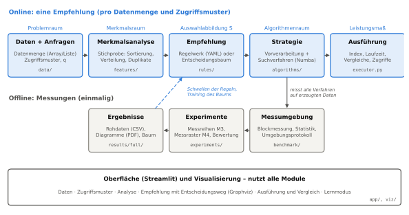

# Architekturübersicht

*Abbildung: Module des Systems, eingeordnet in das Algorithmenauswahlproblem
nach Rice [rice1976]. Vektorgrafik für die Ausarbeitung:
[architektur.pdf](architektur.pdf), neu erzeugbar mit
`python docs/architektur_diagramm.py`.*

## Überblick

Das System folgt dem Rahmen des Algorithmenauswahlproblems [rice1976]:
Aus dem **Problemraum** (Datenmenge und erwartete Anfragen) werden Merkmale
im **Merkmalsraum** bestimmt. Eine **Auswahlabbildung** ordnet ihnen eine
Strategie aus dem **Algorithmenraum** zu, und deren Ausführung wird am
**Leistungsmaß** Laufzeit gemessen. Die Module lassen sich in drei Ebenen
gliedern.

### 1. Online: eine Empfehlung

| Schritt | Modul | Aufgabe |
|---|---|---|
| Problemraum | `data/` | Synthetische Datenmengen mit kontrollierten Eigenschaften (Größe, Verteilung, Sortiergrad, Duplikate), Array oder verkettete Liste; Anfragen mit Trefferquote und Zielposition |
| Merkmalsraum | `features/` | Merkmale per Stichprobe: Anteil falsch geordneter Nachbarpaare, Duplikatanteil, KS-Abstand zur Gleichverteilung. Die Analysekosten werden gemessen. Dazu kommt eine exakte Sortierprüfung in O(n). |
| Auswahlabbildung | `rules/` | Zwei austauschbare Selektoren mit gleichem Ergebnisformat (Strategie, Begründung, Entscheidungsweg): das **Regelwerk** als Entscheidungsgraph in `rules.yaml` und ein **Entscheidungsbaum** (scikit-learn, Tiefe 4), gespeichert als JSON |
| Algorithmenraum | `rules/strategies.py`, `algorithms/` | Strategie = Vorverarbeitung (Sortierprüfung, Sortieren, Hashtabelle) + Suchverfahren. Acht Suchverfahren für Arrays und zwei für Listen, alle mit Numba kompiliert, jeweils in einer Mess- und einer Zählvariante aus derselben Quelle |
| Leistungsmaß | `executor.py` | Führt die Strategie aus und liefert Index, Laufzeit, Vergleiche und Zugriffe |

Beide Selektoren fragen zuerst die kostenlosen Merkmale ab (Datengröße,
Struktur, Angaben des Nutzers). Das Regelwerk zieht die Stichprobe nur, wenn
ein Knoten sie braucht. Das spart die Analysekosten in vielen Fällen
[kerschke2019].

### 2. Offline: Messungen für Regeln und Ausarbeitung

| Modul | Aufgabe |
|---|---|
| `benchmark/` | Messumgebung: Blockmessung (mindestens 1 ms pro Block), verworfene Aufwärmläufe, wechselnde Eingaben pro Wiederholung, zufällige Reihenfolge mit festem Seed; robuste Statistik (Median, Bootstrap-Konfidenzintervall, Minimum, geometrisches Mittel); Umgebungsprotokoll in jeder Ergebnisdatei |
| `experiments/` | Messreihen je Merkmal (M3), Messraster aller Kombinationen und Bewertung der Selektoren (M4); jeweils als Schnelltest oder vollständige Messreihe |
| `results/full/` | Rohdaten (CSV), Diagramme (PDF), Bewertungstabellen (CSV, LaTeX) und der trainierte Entscheidungsbaum |

Aus den Ergebnissen stammen die Schwellen des Regelwerks (kommentiert in
`rules.yaml`) und der trainierte Baum (gestrichelter Pfeil im Diagramm).
Bewertet werden beide auf einer Testhälfte des Messrasters, die für Regeln
und Training nicht verwendet wurde.

### 3. Oberfläche

`app/` (Streamlit) führt in sechs Seiten durch den Ablauf: Daten,
Zugriffsmuster, Analyse, Empfehlung mit Entscheidungsweg, Ausführung mit
Vergleichsmodus und Lernmodus. `viz/` liefert dafür den Entscheidungsweg als
Graphviz-Graph (`graph.py`), die Schritt-für-Schritt-Verfolgung der Verfahren
(`stepper.py`) und den einheitlichen Diagrammstil der Ausarbeitung
(`plots.py`).

## Designentscheidungen

| Entscheidung | Begründung |
|---|---|
| Alle Suchverfahren mit Numba kompiliert | Faire Laufzeitvergleiche: kein Mix aus reinem Python und NumPy-C-Funktionen |
| Eine Quelle, zwei Kompilate (`count_ops`) | Die Zählung kostet Laufzeit. In der Messvariante entfernt der Compiler den Zählcode, ohne dass zwei Implementierungen auseinanderlaufen können. |
| „Erstes Vorkommen“ über die untere Schranke | Einheitliche Ergebnisse bei Duplikaten, ohne O(k)-Nachlauf |
| Strategien statt reiner Suchverfahren | Auf unsortierten Daten gibt es schnelle Verfahren nur mit Vorverarbeitung, deren Kosten Teil der Entscheidung sind. |
| Regelwerk als Daten (YAML) | Lesbar, kommentierbar, zitierfähig. Getrennt von der Programmlogik, gleiches Ergebnisformat wie der Baum. |
| Baum als JSON statt scikit-learn-Objekt | Die App braucht scikit-learn nicht und kann den Weg genauso zeichnen wie beim Regelwerk. |
| Kalibrierungs- und Testhälfte | Regeln und Baum werden unter denselben fairen Bedingungen bewertet. |
