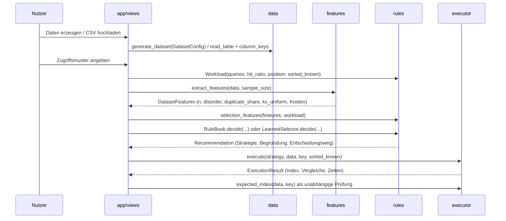

# Code-Dokumentation

Diese Datei erklärt, **was im Code passiert**: Modul für Modul, mit den
wichtigsten Entwurfsentscheidungen und den Stellen, an denen man das Projekt
erweitert. Sie ergänzt die Docstrings im Code (englisch) und die Annahmen in
[annahmen.md](annahmen.md) (A1–A42), auf die hier verwiesen wird.

## Inhalt

1. [Überblick: der Weg einer Anfrage durch das System](#1-überblick-der-weg-einer-anfrage-durch-das-system)
2. [Suchverfahren (`recommender.algorithms`)](#2-suchverfahren-recommenderalgorithms)
3. [Daten (`recommender.data`)](#3-daten-recommenderdata)
4. [Merkmale (`recommender.features`)](#4-merkmale-recommenderfeatures)
5. [Empfehlungssystem (`recommender.rules`)](#5-empfehlungssystem-recommenderrules)
6. [Ausführung (`recommender.executor`)](#6-ausführung-recommenderexecutor)
7. [Messmethodik (`recommender.benchmark`) und Experimente](#7-messmethodik-recommenderbenchmark-und-experimente)
8. [Visualisierung (`recommender.viz`)](#8-visualisierung-recommenderviz)
9. [Oberfläche (`app/`)](#9-oberfläche-app)
10. [Tests](#10-tests)
11. [Erweitern: neues Suchverfahren, neue Regel](#11-erweitern-neues-suchverfahren-neue-regel)

---

## 1. Überblick: der Weg einer Anfrage durch das System

Das Projekt ist in zwei Teile getrennt: Das Python-Paket `src/recommender/`
enthält die gesamte Logik und ist ohne Oberfläche testbar; `app/` ist nur die
Streamlit-Oberfläche darüber.

Ein Durchlauf in der App sieht so aus:



Die Kernbegriffe:

| Begriff | Klasse | Bedeutung |
|---|---|---|
| Datenmenge | `np.ndarray` (int64) oder `LinkedList` | die zu durchsuchenden Schlüssel |
| Zugriffsmuster | `Workload` | Angaben des Nutzers: Anzahl Anfragen q, Trefferquote, Lage der Treffer, Sortiergarantie |
| Merkmale | `DatasetFeatures` | per Stichprobe geschätzte Eigenschaften und ihre Kosten |
| Strategie | `Strategy` | Suchverfahren + nötige Vorverarbeitung (die Auswahlmöglichkeiten) |
| Empfehlung | `Recommendation` | gewählte Strategie, Begründung, besuchte Entscheidungsknoten |
| Ergebnis | `ExecutionResult` | gefundener Index, gezählte Operationen, gemessene Zeiten |

---

## 2. Suchverfahren (`recommender.algorithms`)

### Gemeinsame Konventionen (`_common.py`)

Jedes Verfahren hat die Signatur `search(data, key, ops) -> int` und liefert
den Index des **ersten** Vorkommens oder `-1` (A1). `ops` ist ein kleines
Zähler-Array `[Vergleiche, Zugriffe]` (A3).

**Erstes Vorkommen bei Duplikaten:** Alle Verfahren für sortierte Daten
suchen die *untere Schranke*, also den kleinsten Index `i` mit
`arr[i] >= key`. In sortierten Daten ist das automatisch das erste Vorkommen.
Danach prüft `check_candidate` einmal auf Gleichheit. So braucht kein
Verfahren ein nachträgliches Zurücklaufen über Duplikate.

**Zwei kompilierte Varianten aus einem Quelltext:** Jedes Modul hat eine
Fabrikfunktion `_make_<name>(count_ops)`, die eine mit Numba (`@njit`)
kompilierte Funktion zurückgibt. Der Zählcode steht in `if count_ops:`-Blöcken.
Numba behandelt Closure-Variablen als Konstanten, deshalb entfernt der
Compiler diese Blöcke in der Variante mit `count_ops=False` vollständig.
Laufzeiten werden nur mit der schnellen Variante gemessen, Operationen nur
mit der Zählvariante gezählt; beide stammen aus demselben Quelltext und
können nicht auseinanderlaufen (A4).

```python
def _make_linear_search(count_ops: bool):
    @njit
    def linear_search(arr, key, ops):
        for i in range(arr.shape[0]):
            if count_ops:            # verschwindet in der Messvariante
                ops[ACCESSES] += 1
                ops[COMPARISONS] += 1
            if arr[i] == key:
                return i
        return -1
    return linear_search

linear_search = _make_linear_search(count_ops=False)          # für Zeitmessung
linear_search_counted = _make_linear_search(count_ops=True)   # für Operationszählung
```

### Die Verfahren

| Datei | Idee im Code |
|---|---|
| `linear.py` | Schleife von links nach rechts; einziges Verfahren ohne Voraussetzung. |
| `binary.py` | `make_lower_bound`: klassisches Halbieren mit `if/else`. Die verzweigungsfreie Variante [khuong2017] rechnet `base += half * (arr[base + half] < key)`, damit die CPU keinen Sprung falsch vorhersagen kann. |
| `jump.py` | Springt in Blöcken der Größe √n, bis das Blockende ≥ key ist, und durchsucht dann den Block linear. |
| `exponential.py` | Verdoppelt die Grenze (1, 2, 4, …), bis `arr[bound-1] >= key`, und sucht dann binär im letzten Intervall; Kosten O(log i) für Position i. |
| `fibonacci.py` | Teilt das Intervall nach Fibonacci-Zahlen statt Hälften; das Array gilt bis zur nächsten Fibonacci-Größe als mit +∞ aufgefüllt (diese Positionen werden nie gelesen, A6). |
| `interpolation.py` | Schätzt die Position aus dem Wert (lineare Interpolation, in Gleitkomma gegen Überlauf). Liegt die Schätzung höchstens 8 Elemente vor einem Intervallende, schaltet ein *Guard* auf sequenzielle Suche um [vansandt2019] (A5). |
| `hashing.py` | Eigene Hashtabelle: multiplikatives (Fibonacci-)Hashing, offene Adressierung mit linearem Sondieren, Kapazität 2^b ≥ 2n (Füllgrad ≤ 0,5). Jeder Schlüssel wird nur einmal mit dem Index seines ersten Vorkommens gespeichert (A7). |
| `linked_list.py` | Lineare Suche und Sprungsuche auf der verketteten Liste (Knotenpool, siehe unten). Jeder besuchte Knoten zählt als Zugriff, auch wenn nur der Zeiger verfolgt wird. |

### Registry (`registry.py`)

`ALGORITHMS` (Arrays) und `LIST_ALGORITHMS` (Listen) sind Wörterbücher von
`SearchAlgorithm`-Objekten. Jedes enthält Schlüssel, deutschen Namen, beide
kompilierten Varianten, ob sortierte Daten nötig sind, die Komplexität, die
Quellen und eine `prepare`-Funktion (z. B. Hashtabelle bauen). Alle anderen
Teile des Projekts (Messung, Empfehlung, Ausführung, Oberfläche) holen die
Verfahren nur hier ab: Die Registry ist die einzige Stelle mit dieser
Information.

---

## 3. Daten (`recommender.data`)

### Synthetische Datenmengen (`generators.py`)

`DatasetConfig` beschreibt eine Datenmenge entlang der Merkmale der
Aufgabenstellung: Größe `n`, Verteilung, Sortiergrad, Duplikatanteil,
Speicherstruktur, Seed. Die Konstruktion (A10–A12):

1. Ziehe `n - round(p·n)` **verschiedene** Schlüssel aus der Verteilung
   (`distinct_pool`; seltene Rundungskollisionen werden nachgezogen).
2. Fülle mit Kopien aus diesem Pool auf n auf: Der Duplikatanteil
   `(n - verschieden) / n` ist damit **exakt** p.
3. Ordne sortiert, fast sortiert (sortieren, dann `round(k·n)` zufällige
   Vertauschungen) oder unsortiert (Zufallspermutation).
4. Speichere als Array oder verkettete Liste.

Die kontinuierlichen Verteilungen werden mit großen Faktoren (bis 2⁵²)
skaliert und abgerundet, damit fast keine ungewollten Duplikate entstehen.
Gleicher Seed bedeutet immer gleiche Daten.

### Verkettete Liste als Knotenpool (`linked_list.py`)

Numba kann Python-Objektgraphen nicht effizient verarbeiten. Die Liste ist
deshalb als zwei Arrays gespeichert: `values[s]` ist der Schlüssel im Slot
`s`, `next_index[s]` der Slot des Nachfolgers (`-1` am Ende). Die Knoten
liegen in **zufälligen** Slots, sodass das Verfolgen der Liste wie bei einer
echten Heap-Liste durch den Speicher springt und die CPU nicht vorausladen
kann (A13).

### Anfragen (`queries.py`)

`QueryConfig` erzeugt Suchschlüssel mit einem Zugriffsmuster: Trefferquote
und Lage der Treffer (gleichverteilt oder vorne gehäuft, exponentiell mit
Mittelwert 1 % von n). Fehlschläge liegen in Lücken des Wertebereichs (A15).

Für die Oberfläche gibt es `random_hit_key` und `random_miss_key`. Der
Fehlschlag wird gegen **alle** Werte geprüft (ein vektorisierter Vergleich pro
Kandidat); bei lückenlosem Wertebereich wird Maximum + 1 verwendet (A42).

### CSV-Import (`upload.py`)

`read_table(bytes)` erkennt das Trennzeichen aus der ersten Zeile (`;`, Tab,
`,`, Leerzeichen) und nimmt eine Kopfzeile nur an, wenn die erste Zeile nicht
nur aus Zahlen besteht. Ohne diese Prüfung würde pandas bei einer Datei
`5\n3\n8` die `5` als Spaltennamen verwenden und den ersten Wert verlieren.
`numeric_columns` bietet nur Zahlenspalten an (keine Ja/Nein-Spalten),
`column_keys` wandelt eine Spalte in `int64` um, zählt leere Zellen und lehnt
Nachkommastellen, `inf` und Werte außerhalb von `int64` mit einer deutschen
Fehlermeldung ab (`ValueError`).

---

## 4. Merkmale (`recommender.features`)

Merkmale für die Algorithmenauswahl müssen billig sein [kerschke2019]: Ein
vollständiger Durchlauf kostet so viel wie eine lineare Suche. Deshalb werden
alle Merkmale außer n auf einer **Stichprobe** geschätzt (A16).

`extract_features(data, sample_size)` ruft den kompilierten Kern `_estimate`
auf. Er zieht zufällige Nachbarpaare `(a[i], a[i+1])` (bei Listen: Knoten und
Nachfolger) und zufällige Werte:

| Merkmal | Berechnung | Bedeutung |
|---|---|---|
| `disorder` | Anteil der Paare mit `a[i] > a[i+1]` | 0 = sortiert, ≈ 0,5 = zufällig |
| `duplicate_share` | Anteil gleicher Nachbarn, skaliert mit (n−1)/n | nur bei sortiert wirkenden Daten schätzbar, sonst `None` [charikar2000] |
| `ks_uniform` | Kolmogorow-Smirnow-Abstand der Stichprobe zur Gleichverteilung auf [min, max] | 0 = gleichverteilt (gut für Interpolationssuche), → 1 = schief |
| `analysis_time_ns` | gemessene Zeit des Aufrufs | ohne die einmalige Kompilierung, die vorher auf einer Mini-Eingabe ausgelöst wird (A17) |

Ist die Datenmenge kleiner als die Stichprobe, werden alle Paare verwendet
(exaktes Ergebnis).

`verify_sorted(data)` prüft die Sortierung exakt in einem O(n)-Durchlauf, der
beim ersten Fehler abbricht, und misst die Zeit. Eine Stichprobe kann
Sortierung nie beweisen; ein einziges vertauschtes Paar würde die binäre
Suche falsch machen.

---

## 5. Empfehlungssystem (`recommender.rules`)

### Strategien und Zugriffsmuster (`strategies.py`)

`STRATEGIES` ist der Auswahlraum [rice1976]: lineare Suche, die sechs
Verfahren für sortierte Arrays, „Hashtabelle aufbauen + Lookup“, „Sortieren +
verzweigungsfreie binäre Suche“ und drei Listen-Strategien. Eine Strategie
kennt ihr Suchverfahren, ihre Vorverarbeitung und ob sie sortierte Daten
braucht (A26).

`Workload` speichert die Nutzerangaben. Die Eigenschaft `linear_scans`
(= q · gelesener Anteil pro Suche) fasst sie zu einer Zahl zusammen: Wie viele
komplette Durchläufe würde die lineare Suche für alle Anfragen brauchen? Eine
Vorverarbeitung lohnt sich ungefähr, wenn sie weniger kostet als diese
Durchläufe (A33).

### Gemeinsames Ergebnisformat (`decision.py`)

`selection_features(features, workload)` macht aus Merkmalen und
Zugriffsmuster ein flaches Wörterbuch von Zahlen (auch abgeleitete Größen wie
`log10_n`, `queries_per_n`). Beide Selektoren lesen nur daraus.
`Recommendation` enthält Strategie, Begründung, Quellen und den Pfad als
Liste von `DecisionStep` (Frage, Merkmal, gemessener Wert, Schwelle,
Antwort). `uses_sampled_features` sagt, ob die Stichprobe nötig war, also ob
die Analysekosten anfallen.

### Regelwerk (`rules.yaml` + `rulebook.py`)

Die Regeln sind **Daten, kein Code**: `rules.yaml` beschreibt einen
Entscheidungsgraphen. Jeder Knoten hat Frage, Merkmal, Vergleichsoperator,
Schwelle, Ziel bei „ja“ und „nein“, Begründung und Quellen; jedes Blatt eine
Strategie mit Begründung in einem Satz. Die Kommentare oben in der Datei
erklären, aus welcher Messung jede Schwelle stammt.

Die Reihenfolge der Fragen ist bewusst: zuerst die kostenlosen Merkmale
(Struktur, n, Nutzerangaben), die Stichprobe (`looks_sorted`) erst, wenn ein
Knoten sie braucht. Bei n ≤ 100 wird nie eine Stichprobe gezogen, weil sie
dort mehr kostet als Dutzende lineare Suchen (A34).

`RuleBook.load()` liest die Datei und **validiert** sie: Alle Ziele müssen
existieren, Operatoren und Merkmale bekannt sein, Strategien gültig, und der
Graph darf keinen Zyklus enthalten. `decide(features)` läuft vom Startknoten
bis zu einem Blatt und protokolliert jeden Schritt.

### Gelernter Entscheidungsbaum (`learned.py`)

`train_tree` trainiert einen scikit-learn-`DecisionTreeClassifier`
(Entropie wie ID3 [quinlan1986], Tiefe 4, mindestens 20 Fälle pro Blatt) auf
den Instanzen des Messrasters; die Zielklasse ist jeweils die beste Strategie
(Oracle). `LearnedSelector` speichert den Baum als einfache Listen in JSON,
damit die App **ohne scikit-learn** entscheiden und den Pfad genauso zeichnen
kann wie beim Regelwerk.

### Instanzen und Bewertung (`instances.py`, `evaluation.py`)

`build_instances` erzeugt aus dem Messraster für jede Kombination aus
Datensatz, Zugriffsmuster, q und Sortiergarantie die Gesamtkosten jeder
Strategie nach dem linearen Kostenmodell *Vorverarbeitung + q · Kosten pro
Anfrage* (A22) und die beste Strategie (Oracle). `evaluation.py` berechnet
daraus Trefferquote, Slowdown (geometrisches Mittel [fleming1986], Median,
95 %-Quantil, Maximum) und die geschlossene Lücke zwischen Single Best Solver
und Oracle [kerschke2019], jeweils mit und ohne Analysekosten. Eine
fehlgeschlagene Sortierprüfung wird realistisch modelliert: Ihre Kosten
werden bezahlt, dann wird neu entschieden.

---

## 6. Ausführung (`recommender.executor`)

`execute(strategy_key, data, key, sorted_known)` führt genau die Schritte
einer Strategie aus:

1. **Sortierprüfung**, wenn die Strategie sortierte Daten braucht und der
   Nutzer die Sortierung nicht garantiert. Schlägt sie fehl, wird nicht
   gesucht (`check_failed=True`); die Oberfläche entscheidet dann neu.
2. **Vorverarbeitung**: Sortieren mit stabilem `np.argsort` (die
   Permutation rechnet den gefundenen Index auf die Originalposition zurück;
   wegen der Stabilität bleibt das erste Vorkommen erhalten, A37), Hashtabelle
   bauen oder Liste in eine Hashtabelle kopieren.
3. **Suche**: einmal mit der Zählvariante (Index, Vergleiche, Zugriffe) und
   1 000-mal mit der Messvariante in einer kompilierten Schleife (Zeit pro
   Anfrage, A36).

`ExecutionResult.total_ns(q)` schätzt die Gesamtkosten für q Anfragen nach
dem Kostenmodell. `compare_all` führt alle anwendbaren Strategien aus
(Vergleichsmodus). `expected_index` berechnet das richtige Ergebnis
unabhängig mit NumPy; die Oberfläche markiert damit jedes Ergebnis als
richtig oder falsch (A41). `warm_up` kompiliert alle Verfahren einmal auf
Mini-Eingaben.

---

## 7. Messmethodik (`recommender.benchmark`) und Experimente

| Modul | Aufgabe |
|---|---|
| `timing.py` | Eine Suche dauert Nanosekunden, weniger als die Timerauflösung. Gemessen werden deshalb **Blöcke** von Anfragen in einer kompilierten Schleife (`block_runner`); die Blocklänge wird verdoppelt, bis ein Block ≥ 1 ms dauert. Aufwärmläufe werden verworfen, jede Wiederholung zieht **neue** Schlüssel, damit die CPU sich nicht auf identische Eingaben einstellt (A19, A20). |
| `statistics.py` | Median mit 95 %-Bootstrap-Konfidenzintervall, Minimum, Speedups mit geometrischem Mittel [chen2016], [fleming1986]. |
| `environment.py` | Protokolliert Hardware, Software, Stromquelle und Stromsparmodus als Kommentarzeilen über jeder CSV-Datei [hoefler2015]; warnt bei gedrosselter CPU (A35). |
| `runner.py` | Führt eine Messreihe aus; Reihenfolge von Konfigurationen und Verfahren wird mit festem Seed zufällig gemischt [mytkowicz2009]. |
| `grid.py` | Das Messraster für das Empfehlungssystem: pro Datensatz alle Kostenbestandteile (Prüfung, Sortieren, Hashaufbau, Kosten pro Anfrage je Verfahren und Zugriffsmuster, Analysekosten). |
| `experiment.py` | Gemeinsame Hilfen der Skripte: Modi `quick`/`full`, Ergebnispfade `results/<modus>/`, `--plot-only`. |

Die Skripte in `experiments/` (Tabelle in der README) messen je ein Merkmal
nach dem Prinzip „ein Faktor zur Zeit“ (A23), `exp_grid.py` alle
Kombinationen, `exp_recommender.py` bewertet die Selektoren auf einer
getrennten Testhälfte (A30).

---

## 8. Visualisierung (`recommender.viz`)

| Modul | Aufgabe |
|---|---|
| `plots.py` | Einheitlicher Matplotlib-Stil der PDF-Diagramme für die Arbeit: Jedes Verfahren hat überall dieselbe Farbe und dasselbe Symbol (farbfehlsichtigkeitsgeprüfte Palette). |
| `graph.py` | Erzeugt den Entscheidungsgraphen als Graphviz-DOT-Text: kompakter Pfad (`path_dot`, mit der jeweils nicht gewählten Abzweigung gestrichelt) oder vollständiger Graph für Regelwerk (`rulebook_dot`) und Baum (`tree_dot`). Der aktive Pfad ist blau, jeder besuchte Knoten zeigt den gemessenen Wert. |
| `stepper.py` | Nachbau jedes Verfahrens in reinem Python, der jeden Vergleich als `Step` mit deutschem Erklärtext aufzeichnet (Bereich `lo..hi`, verglichene Position, markierte Blockgrenzen der Sprungsuche). Die Tests stellen sicher, dass jede Spur mit demselben Ergebnis endet wie das kompilierte Verfahren. |
| `formatting.py` | Deutsche Zahlen- und Zeitformatierung (`german`, `format_ns`, `percent`): Dezimalkomma, Tausenderpunkte, Einheiten ns bis h, keine wissenschaftliche Schreibweise. |

---

## 9. Oberfläche (`app/`)

### Aufbau

- `streamlit_app.py` registriert die sechs Seiten (`st.Page`) in zwei
  Gruppen („Werkzeug“ 1–5, „Lernen“ 6), legt sie in `common.PAGES` ab und
  zeichnet die Seitenleiste.
- `views/common.py` enthält alles, was mehrere Seiten brauchen: Beschriftungen,
  Seitenkopf mit Fortschrittsleiste (`page_header`), Link zum nächsten Schritt
  (`next_step`), Steckbrief einer Strategie (`strategy_properties`),
  zwischengespeicherte Ressourcen und den Sitzungszustand.
- `views/charts.py` baut die interaktiven Altair-Diagramme (Histogramm, Wert
  über Position, Verteilungsfunktion, Strategievergleich, Schrittzahlen).
- `views/<seite>_page.py`: je eine Seite mit einer Funktion `render()`.
- `.streamlit/config.toml` legt das Farbschema für hellen und dunklen Modus
  fest; Blau (#2a78d6) bedeutet überall „gewählt / aktiv“.

### Zustand und Zwischenspeicher

Streamlit führt das Skript bei jeder Interaktion neu aus. Was erhalten
bleiben muss, liegt in `st.session_state` (siehe Docstring von
`common.py`). Drei Regeln halten den Zustand konsistent:

1. **`set_data` setzt alles Abgeleitete zurück** (Merkmale, Sortierprüfung,
   Ausführungsergebnisse) und erhöht `data_version`.
2. **Merkmale werden mit ihrer Stichprobengröße gespeichert**
   (`features_sample_size`). `current_features()` rechnet neu, sobald Daten
   oder Stichprobengröße sich ändern, sodass Analyse, Empfehlung und
   Ausführung immer dieselben Werte sehen.
3. **Ausführungsergebnisse werden mit dem Zustand gespeichert, für den sie
   berechnet wurden** (`(data_version, key, workload, selector,
   sample_size)`). Weicht der aktuelle Zustand ab, wird neu ausgeführt.

`@st.cache_resource` hält prozessweit, was teuer und für alle Sitzungen
gleich ist: die einmalige Numba-Kompilierung (`compiled`), das Regelwerk und
den gelernten Baum.

### Die Seiten

| Seite | Wichtige Logik |
|---|---|
| 1 Daten | Formular für den Generator; CSV-Import über `read_table` → `numeric_columns` → `column_keys` mit Vorschau; Kennzahlen und zwei Diagramme in Reitern. |
| 2 Zugriffsmuster | Zufälliger Treffer/Fehlschlag mit ungesetztem Zufallsgenerator (jeder Klick neu); zeigt sofort, ob und wo der Schlüssel vorkommt; Warnung, wenn „garantiert sortiert“ angekreuzt ist, die Stichprobe aber Unordnung findet. |
| 3 Analyse | Stichprobengröße bleibt beim Seitenwechsel erhalten; Kennzahlen, Klartext „Was das für die Suchverfahren bedeutet“, Verteilungsfunktion gegen Gleichverteilung (der größte Abstand ist der KS-Wert), vollständige Sortierprüfung auf Knopfdruck. |
| 4 Empfehlung | Wahl des Selektors; Karte mit Strategie, Begründung, Komplexität, Vorverarbeitung; Vergleich mit dem anderen Selektor; Entscheidungsweg als Graph und Tabelle; DOT-Export. |
| 5 Ausführung | Führt die Empfehlung aus (bei fehlgeschlagener Sortierprüfung wird mit „unsortiert“ neu entschieden), prüft das Ergebnis gegen `expected_index`, Vergleichsmodus mit Tabelle (Spalte „Korrekt“) und Balkendiagramm (log-Skala). |
| 6 Lernmodus | Kleines Beispiel-Array (Werte auf 0–999 skaliert); ein neues Array startet mit einem enthaltenen Schlüssel; Weiter/Zurück/Zum Ende/Neustart, Fortschrittsbalken, farbige Zellen, Vergleich der Schrittzahlen aller Verfahren für denselben Schlüssel. |

---

## 10. Tests

| Datei | Prüft |
|---|---|
| `test_algorithms.py` | jedes Verfahren gegen `np.searchsorted` bzw. erstes Vorkommen, Randfälle (leer, ein Element, Duplikate, extreme Werte), Zählvarianten |
| `test_linked_list_algorithms.py` | Listenverfahren und Knotenpool |
| `test_data.py` | Generatoren (exakter Duplikatanteil, Sortiergrade, Determinismus), Anfragen |
| `test_features.py` | Merkmalsschätzung und Sortierprüfung |
| `test_benchmark.py` | Zeitmessung, Statistik (Bootstrap, Speedups), Umgebungsprotokoll, Messreihen-Runner |
| `test_rules.py` | Regelwerk (Validierung, Entscheidungen), Baum, Instanzen, Bewertung |
| `test_ui_logic.py` | Executor, Entscheidungsgraphen, Lernmodus-Spuren |
| `test_formatting_upload.py` | Zahlenformatierung, CSV-Import, Zufallsschlüssel, Referenzergebnis |
| `test_app.py` | jede Seite rendert ohne Fehler (Streamlit `AppTest`), Vergleichsmodus, Lernmodus, Warnung bei falscher Sortiergarantie, Ergebnisprüfung |

```bash
pytest
```

---

## 11. Erweitern: neues Suchverfahren, neue Regel

**Neues Suchverfahren**

1. Neue Datei in `src/recommender/algorithms/` mit einer Fabrik
   `_make_<name>(count_ops)` nach dem Muster oben; für sortierte Daten die
   untere Schranke suchen und mit `make_check_candidate` abschließen.
2. In `registry.py` als `SearchAlgorithm` eintragen (Name, Komplexität,
   Quellen, `requires_sorted`).
3. Falls es empfohlen werden soll: in `rules/strategies.py` eine `Strategy`
   anlegen und in `rules.yaml` ein Blatt darauf zeigen lassen; in
   `viz/plots.py` Farbe und Symbol vergeben.
4. Für den Lernmodus eine Spurfunktion in `viz/stepper.py` schreiben und in
   `TRACERS` eintragen.
5. Die Tests in `test_algorithms.py` laufen über die Registry und prüfen das
   neue Verfahren automatisch.

**Neue oder geänderte Regel**

Nur `rules.yaml` bearbeiten: Knoten mit Frage, Merkmal (aus
`FEATURE_NAMES_DE` in `rules/decision.py`), Operator, Schwelle, Zielen und
Begründung. `RuleBook.load()` meldet fehlerhafte Verweise, unbekannte
Merkmale und Zyklen. Danach `python experiments/exp_recommender.py --mode full`
ausführen, um die Wirkung auf Trefferquote und Slowdown zu sehen.
